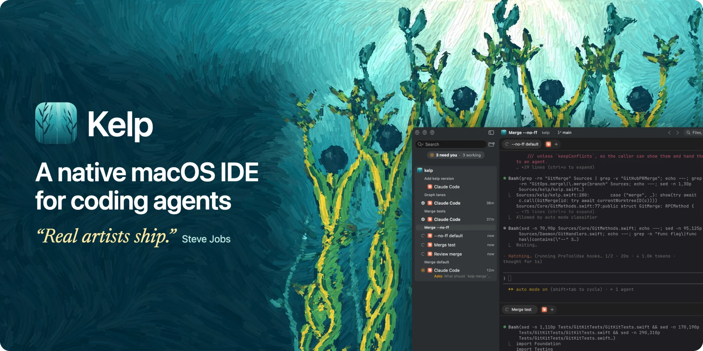

<div align="center">



**Run Claude Code, Codex, Gemini CLI or any other CLI agent side by side in a native Mac app.**<br/>
See who needs you at a glance, and read every change right beside the agent that made it.

<a href="https://github.com/nikiomori/kelp/releases/latest/download/Kelp.dmg"></a>

<sub>Free and open source · macOS 14+ · Apple Silicon and Intel</sub>

[](https://github.com/nikiomori/kelp/releases/latest)
[](https://github.com/nikiomori/kelp/actions/workflows/ci.yml)
[](LICENSE)

</div>

## Why Kelp

Editors gave agents a side panel. Agent apps tucked the code away, and each speaks for one vendor. Kelp is built for how
the work goes now: several agents running, one person deciding.

**Simple things should be simple.** Starting an agent, seeing who needs you and reading what it changed each take one
step, with nothing to set up first.

<table>
<tr>
<td width="33%" valign="top">
<b>Any agent</b><br/><br/>
22 CLI agents work out of the box, and so does any other command. Kelp has no chat or model of its own: you run the
tools you already use, on the plans you already pay for.
</td>
<td width="33%" valign="top">
<b>The code in sight</b><br/><br/>
An editor with language servers, diffs and Source Control share the window with your agents. What they changed is one
tab away, ready to read, fix and commit.
</td>
<td width="33%" valign="top">
<b>Made for the Mac</b><br/><br/>
Swift and AppKit, with a libghostty terminal. Agents live in a background service, so they outlast quitting or updating
the app. No Electron, no account, no cloud, no telemetry.
</td>
</tr>
</table>

<p align="center"><sub>
Claude Code · Codex · OpenCode · Gemini CLI · Cursor Agent · GitHub Copilot · Grok · Antigravity · Amp · Aider · Goose ·
Droid · Kilo Code · Qwen Code · Kimi · Pi · oh-my-pi · Crush · Hermes · Augment · Kiro · fx
</sub></p>

## How it works

### 1. Start your agents

<kbd>⌘N</kbd> opens a workspace, a clean desk in your project. Each agent gets a pane of its own, and four make a 2×2
grid. Every one is the real CLI in a real terminal, with your config and your plan.


### 2. Get on with your day

Each agent's state sits on its row in the sidebar: working, finished, or waiting for you, with its question right there.
<kbd>⇧⌘U</kbd> goes to the next one that needs you. Allow a command or send a reply straight from the notification.


### 3. Read what they did

Open the diff beside the agent that wrote it. Stage or discard a hunk, or comment on a line and send your comments back
to the agent.


### 4. Ship it

Commit, push and open a pull request from Source Control, which works as in VS Code, branch graph included. CI shows on
the branch, and **Fix with Agent** hands a failed check to an agent along with its log.

## Also in the box

<table>
<tr>
<td width="33%" valign="top">
<b>Editor</b><br/>
Language servers, several cursors, VS Code's editing commands, Markdown and notebook previews.
</td>
<td width="33%" valign="top">
<b>Browser</b><br/>
A tab beside your code. A blank one lists the ports your agents and terminals are serving.
</td>
<td width="33%" valign="top">
<b>Run</b><br/>
▶ in the title bar offers what your project can run, from npm scripts to make targets. <kbd>⌘R</kbd> runs it again.
</td>
</tr>
<tr>
<td valign="top">
<b>Issues</b><br/>
Pull requests and CI from GitHub and GitLab, Bitbucket pull requests, Linear and Jira issues. <b>Start Agent on This</b>
hands one to a new agent.
</td>
<td valign="top">
<b>Routines</b><br/>
An agent on a schedule, in a workspace of its own. A run missed while the Mac slept happens when it wakes.
</td>
<td valign="top">
<b>Usage</b><br/>
Plan limits in the sidebar, tokens by day, agent, model and project. When a limit stops an agent, it can go on in another
one, or by itself at the reset.
</td>
</tr>
<tr>
<td valign="top">
<b>Hand Off</b><br/>
Pass a job to another agent, briefed with the first one's transcript.
</td>
<td valign="top">
<b>Open over SSH</b><br/>
Work in a project on another machine. With tmux on the host, a dropped connection doesn't stop its agents.
</td>
<td valign="top">
<b>Extensions</b><br/>
Panels, commands, settings, themes and agents. A JSON file is enough, and the
<a href="https://github.com/nikiomori/kelp-extensions">library</a> has ready ones.
</td>
</tr>
</table>

## Install

Requires macOS 14+. Download [`Kelp.dmg`](https://github.com/nikiomori/kelp/releases/latest/download/Kelp.dmg) and
drag Kelp to Applications; it updates itself (Kelp › Check for Updates…). Keep it allowed in System Settings › General ›
Login Items & Extensions: that's what lets agents outlast the app. Kelp's terminals have `kelp` on their PATH; for
other terminals: `ln -s /Applications/Kelp.app/Contents/MacOS/kelp /usr/local/bin/kelp`.

**Kelp Beta** is what's coming, ahead of a release (Routines, for one): [`Kelp-Beta.dmg`](https://github.com/nikiomori/kelp/releases/download/beta/Kelp-Beta.dmg).
It installs beside Kelp as an app of its own (its settings, projects and agents in `~/.kelp-beta`) and updates itself
with each new beta. It can break; Kelp is unaffected.

## CLI

Everything the window does, `kelp` does too, so agents can drive Kelp as well (`kelp help` lists it all).

```sh
kelp status
kelp session new --agent claude                        # in the current folder's workspace
kelp session new --cmd "npm test" --split down --wait  # beside yours; exits with its code
kelp open Sources/App.swift:42 --split right           # a tab in the app
kelp worktree create feat/login | list | current | note "half done"
kelp terminal list | read <id> | send <id> "run the tests" | context <id>
kelp diff | commit "msg" | merge | push
kelp ext search | install <id>                         # the extension library
kelp install                                           # run the daemon as a LaunchAgent
```

Claude Code sessions get Kelp's skills for this (Settings › Agents): ask the agent for a panel, a setting or a theme.

## Per-repo config: `.kelp.yaml`

```yaml
setup: npm install              # runs in every new worktree
shared: node_modules            # symlinked from the main checkout instead of reinstalling
tabs: claude, shell             # sessions opened in each new worktree
run: npm run dev                # Run menu (⌘R). Also test (⌘U), lint, build, script.<name>
test: npm test
issueCommand: "Fix {title}: {body}"
recipe.commit: "Write a conventional commit for: {stagedPatch}"
```

Its commands run only after you trust the project in Kelp, and ask again when the file changes.
`.worktreeinclude` lists gitignored files (globs) copied into new worktrees, e.g. `.env*`.

## Extensions

An extension is a folder with an `extension.json` in `~/.kelp/extensions`: a panel that shows what a command prints,
commands, settings, themes, agents. Format: [docs/extensions.md](docs/extensions.md). Ready ones are in the
[library](https://github.com/nikiomori/kelp-extensions) (Settings › Extensions › Library, or `kelp ext search`).

## Build from source

```sh
scripts/build-ghostty.sh  # once: libghostty into Vendor/ (downloads zig 0.16 into a cache)
swift build               # everything
swift test                # all tests
.build/debug/KelpApp      # starts kelpd next to it if needed; keeps its data in ~/.kelp-dev
make dev                  # Kelp Dev: a debug build beside Kelp, with a copy of its projects
scripts/bundle.sh         # dist/Kelp.app + dist/Kelp.dmg (universal, release)
```

Signing, channels and releases: [docs/releasing.md](docs/releasing.md).

## More

[Architecture](docs/architecture.md) · [Contributing](CONTRIBUTING.md) · [Security](SECURITY.md) ·
[Code of Conduct](CODE_OF_CONDUCT.md) · MIT [license](LICENSE)
