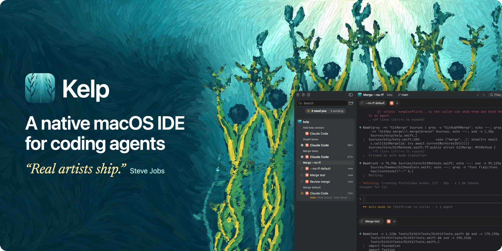
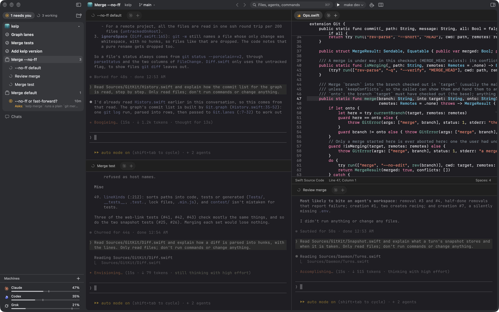
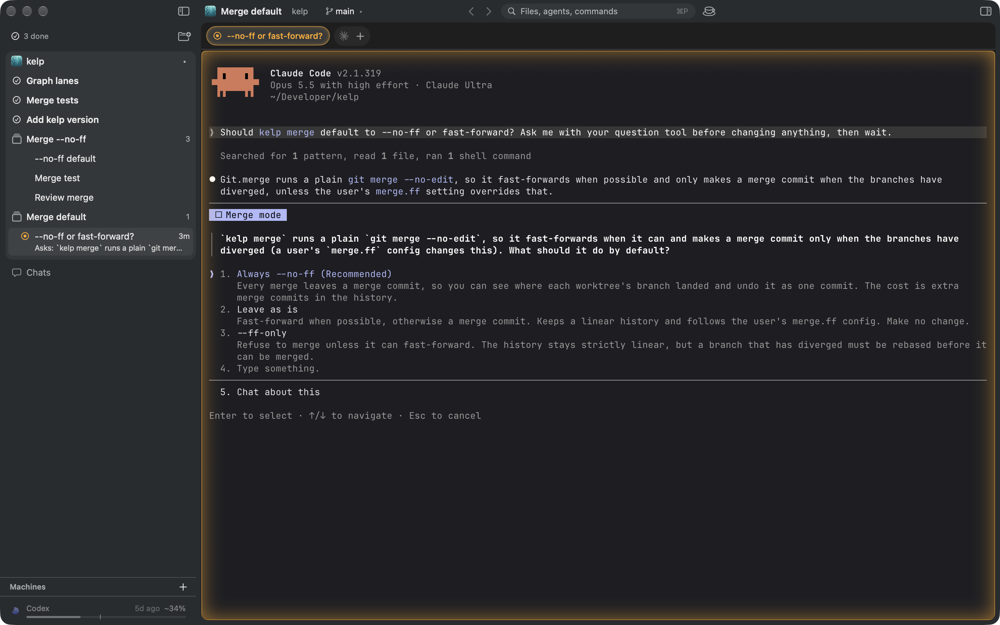
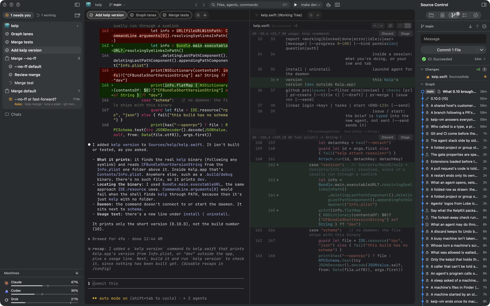

<div align="center">



**Run Claude Code, Codex, Antigravity or any other CLI agent side by side in a native Mac app.**<br/>
See who needs you at a glance, and read every change right beside the agent that made it.<br/>
<sub>For people who run a few agents and still read the code.</sub>

<a href="https://github.com/nikiomori/kelp/releases/latest/download/Kelp.dmg"></a>

<sub>Free and open source · macOS 14+ · Apple Silicon and Intel</sub>

[](https://github.com/nikiomori/kelp/releases/latest)
[](https://github.com/nikiomori/kelp/actions/workflows/ci.yml)
[](LICENSE)

</div>

## Why Kelp

Editors gave agents a side panel. Agent apps tucked the code away, and each speaks for one vendor. Kelp is built for how
the work goes now: several agents running, one person deciding.

**Simple things should be simple.** Starting an agent, seeing who needs you and reading what it changed each take one
step, with nothing to set up first.

<table>
<tr>
<td width="33%" valign="top">
<b>Any agent</b><br/><br/>
22 CLI agents work out of the box, and so does any other command. Kelp has no chat or model of its own: you run the
tools you already use, on the plans you already pay for.
</td>
<td width="33%" valign="top">
<b>The code in sight</b><br/><br/>
An editor with language servers, diffs and Source Control share the window with your agents. What they changed is one
tab away, ready to read, fix and commit.
</td>
<td width="33%" valign="top">
<b>Made for the Mac</b><br/><br/>
Swift and AppKit, with a libghostty terminal. Agents live in a background service, so they outlast quitting or updating
the app. No Electron, no account, no cloud, no telemetry.
</td>
</tr>
</table>

<p align="center"><sub>
Claude Code · Codex · Gemini CLI · Antigravity · OpenCode · Cursor Agent · GitHub Copilot · Grok · Amp · Aider · Goose ·
Droid · Kilo Code · Qwen Code · Kimi · Pi · oh-my-pi · Crush · Hermes · Augment · Kiro · fx
</sub></p>

## How it works

### 1. Start your agents

<kbd>⌘N</kbd> opens a new chat beside the ones you have. Each agent gets a pane of its own, and four make a 2×2
grid. Every one is the real CLI in a real terminal, with your config and your plan.



### 2. Get on with your day

Each agent's state sits on its row in the sidebar: working, finished, or waiting for you, with its question right there.
Nothing to set up: Kelp knows it from the agent itself, and says so when it's only reading the screen.
<kbd>⇧⌘U</kbd> goes to the next one that needs you. Allow a command or send a reply straight from the notification.



### 3. Read what they did

Open the diff beside the agent that wrote it, by turn or for the whole branch. Tick files as you read them, search the
diff, stage or discard a hunk (with Undo), or comment on a line and send your comments back to the agent.

**Review with** hands the change to a second agent, say Codex reviewing what Claude wrote. Its findings land as comments
on the lines; the ones you tick go back to the first agent in one message.



### 4. Ship it

Commit, push and open a pull request from Source Control, which works as in VS Code, branch graph included. CI shows on
the branch, and **Fix with Agent** hands a failed check to an agent along with its log.

## Also in the box

<table>
<tr>
<td width="33%" valign="top">
<b>Editor</b><br/>
Language servers, several cursors, VS Code's editing commands, Markdown and notebook previews.
</td>
<td width="33%" valign="top">
<b>Browser</b><br/>
A tab beside your code. A blank one lists the ports your agents and terminals are serving. Agents open, read and click
pages in it too, while you watch.
</td>
<td width="33%" valign="top">
<b>Run</b><br/>
▶ in the title bar offers what your project can run, from npm scripts to make targets. <kbd>⌘R</kbd> runs it again.
</td>
</tr>
<tr>
<td valign="top">
<b>Issues</b><br/>
Pull requests and CI from GitHub and GitLab, Bitbucket pull requests, Linear and Jira issues. <b>Start Agent on This</b>
hands one to a new agent.
</td>
<td valign="top">
<b>Routines</b><br/>
An agent on a schedule, in a group of its own. A run missed while the Mac slept happens when it wakes.
</td>
<td valign="top">
<b>Usage</b><br/>
Plan limits in the sidebar, tokens by day, agent, model and project. When a limit stops an agent, it can go on in another
one, or by itself at the reset.
</td>
</tr>
<tr>
<td valign="top">
<b>Agents together</b><br/>
An agent can start another beside it, say a review by a different model, and its result comes back by itself.
<b>Hand Off</b> passes a job on, briefed with the transcript.
</td>
<td valign="top">
<b>Open over SSH</b><br/>
Work in a project on another machine. With tmux on the host, a dropped connection doesn't stop its agents.
</td>
<td valign="top">
<b>Extensions</b><br/>
Panels, commands, settings, themes and agents. A JSON file is enough, and the
<a href="https://github.com/nikiomori/kelp-extensions">library</a> has ready ones.
</td>
</tr>
<tr>
<td valign="top">
<b>Machines</b><br/>
Linux and macOS machines on Apple Virtualization, Android emulators, iOS simulators. Agents run commands there, in the
project's folder at the same path, and tap the app on its screen.
</td>
<td valign="top">
<b>Artifacts</b><br/>
Docs, reviews, slides, designs and dashboards an agent makes for you, in a tab with their versions. Select text on one to
ask the agent about it.
</td>
<td valign="top">
<b>Dock</b><br/>
Kelp's Dock icon shows the agents or the plan; right-click it to allow a command. A strip in a corner of the screen says who
needs you while you're in another app.
</td>
</tr>
</table>

## How light it is

Measured on 5 November 2026, an M4 Max with 48 GB on macOS 27.0.1. Each app was opened three times with no agents
running; each number is the median of the three, or the range where they differed widely.

| | Opens a window in | Memory (all its processes) | CPU when idle |
| --- | --- | --- | --- |
| **Kelp 0.9.0** (app and background service) | 0.3 s | 81 MB | 0.8 % |
| Orca 1.4.229 (Electron) | 0.9 s | 1.2 GB | 4–19 % |
| Herdr 0.9.5 (in a terminal) | 0.3 s | 17 MB, plus the terminal it runs in | 0.1 % |

<details><summary>How it was measured</summary>

- **Opens a window in:** from launching it to its first window on screen (`CGWindowListCopyWindowInfo`, polled every
  20 ms); for Herdr, to its first screen in a 120 × 40 pseudo-terminal.
- **Memory:** the sum of `phys_footprint` (`footprint -p`) over every process the launch started, 20 s after the window.
- **CPU when idle:** the CPU time those processes used over the next 30 s.
- Kelp ran with a home of its own (`KELP_HOME`) whose usage index was already built: the first launch reads every
  agent's logs once, about 25 s of CPU on a heavy user's Mac. Orca ran with its existing settings; its first run of the
  three used 50 % CPU while starting up.
- Not measured yet: Paradev, and four agents working in each app. [How Kelp compares](docs/comparison.md) beyond weight.

</details>

## Install

Requires macOS 14+. Download [`Kelp.dmg`](https://github.com/nikiomori/kelp/releases/latest/download/Kelp.dmg) and
drag Kelp to Applications; it updates itself (Kelp › Check for Updates…). Keep it allowed in System Settings › General ›
Login Items & Extensions: that's what lets agents outlast the app. Kelp's terminals have `kelp` on their PATH; for
other terminals: `ln -s /Applications/Kelp.app/Contents/MacOS/kelp /usr/local/bin/kelp`.

With Homebrew, `brew install --cask nikiomori/tap/kelp` does both: Kelp in Applications and `kelp` on your PATH (add
`--adopt` if Kelp is already there from the DMG).

### From your phone

Agents go on with Kelp's window closed, and `kelp agents` shows them in any terminal: who needs you comes first, `y` or
`n` answers a permission request, Enter opens the agent and Ctrl+\ comes back. To reach it from a phone:

1. Link `kelp` as above and turn on System Settings › General › Sharing › Remote Login.
2. Keep Kelp allowed in Login Items, and the Mac awake while you're away from it.
3. Connect with any SSH app, then run `kelp agents`. [Tailscale](https://tailscale.com) reaches the Mac from outside your
   network without opening a port.

**Kelp Beta** is what's coming, ahead of a release: [`Kelp-Beta.dmg`](https://github.com/nikiomori/kelp/releases/download/beta/Kelp-Beta.dmg).
It installs beside Kelp as an app of its own (its settings, projects and agents in `~/.kelp-beta`) and updates itself
with each new beta. It can break; Kelp is unaffected.

## CLI

Everything the window does, `kelp` does too, so agents can drive Kelp as well (`kelp help` lists it all).

```sh
kelp status
kelp session new --agent claude                        # in the current folder's workspace
kelp session new --cmd "npm test" --wait               # on your line; exits with its code
kelp open Sources/App.swift:42 --split right           # a tab in the app
kelp worktree create feat/login | list | current | note "half done"
kelp terminal list | read <id> | send <id> "run the tests" | context <id>
kelp wait --children all                               # inside an agent: until the agents it started are done
kelp browser open http://localhost:3000 | snapshot | click e12  # a page in a tab beside you
kelp vm run linux -- make test                         # in a machine, in this project's folder
kelp artifact new doc "Release plan"                   # a page in .kelp/artifacts, opened beside you
kelp diff | commit "msg" | merge | push
kelp ext search | install <id>                         # the extension library
kelp schema session.create                             # the daemon's API; --openrpc for all of it
```

Claude Code sessions get Kelp's skills for this (Settings › Agents): ask the agent for a panel, a setting or a theme.

## Per-repo config: `.kelp.yaml`

```yaml
setup: npm install              # runs in every new worktree
shared: node_modules            # symlinked from the main checkout instead of reinstalling
clone: .venv                    # or each worktree gets its own copy, an APFS clone: seconds, next to no disk
tabs: claude, shell             # sessions opened in each new worktree
run: PORT=$KELP_PORT npm run dev   # Run menu (⌘R). Also test (⌘U), lint, build, script.<name>
test: npm test
issueCommand: "Fix {title}: {body}"
recipe.commit: "Write a conventional commit for: {stagedPatch}"
```

Its commands run only after you trust the project in Kelp, and ask again when the file changes.
Every folder gets ten ports of its own: `$KELP_PORT` and the nine after it (`$((KELP_PORT+1))`), the same each time, so
two copies of an app run side by side.
`.worktreeinclude` lists gitignored files (globs) copied into new worktrees, e.g. `.env*`.

**Coming from another tool?** With no `.kelp.yaml`, Kelp reads the one the project already has: Conductor
(`.conductor/settings.toml`, `conductor.json`), Codex (`.codex/environments/*.toml`), Cursor (`.cursor/worktrees.json`),
Superset / Paradev, Emdash, JetBrains Air, Supacode, cmux. Their setup runs in each new worktree, their run and named
commands go in the Run menu, and the teardown is the `archive` command there. Scripts get the variables they expect
(`$CONDUCTOR_ROOT_PATH`, `$CONDUCTOR_PORT`…). VS Code's and Zed's tasks are in the Run menu as well.

## Extensions

An extension is a folder with an `extension.json` in `~/.kelp/extensions`: a panel that shows what a command prints,
commands, settings, themes, agents. Format: [docs/extensions.md](docs/extensions.md). Ready ones are in the
[library](https://github.com/nikiomori/kelp-extensions) (Settings › Extensions › Library, or `kelp ext search`).

Your own tools can drive Kelp too: the background service answers JSON-RPC on a local socket, and what's public there only
grows from release to release ([docs/rpc.md](docs/rpc.md)).

## Build from source

```sh
scripts/build-ghostty.sh  # once: libghostty into Vendor/ (downloads zig 0.16 into a cache)
swift build               # everything
swift test                # all tests
.build/debug/KelpApp      # starts kelpd next to it if needed; keeps its data in ~/.kelp-dev
make dev                  # Kelp Dev: a debug build beside Kelp, with a copy of its projects
scripts/bundle.sh         # dist/Kelp.app + dist/Kelp.dmg (universal, release)
```

Signing, channels and releases: [docs/releasing.md](docs/releasing.md).

## More

[Architecture](docs/architecture.md) · [Kelp next to Orca, Herdr, cmux, Paradev and Zed](docs/comparison.md) · [Contributing](CONTRIBUTING.md) · [Security](SECURITY.md) ·
[Code of Conduct](CODE_OF_CONDUCT.md) · MIT [license](LICENSE)
