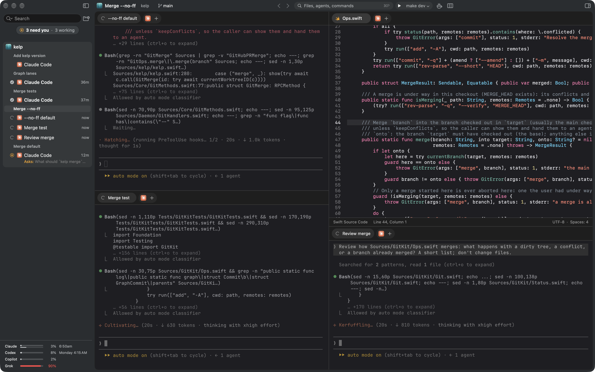
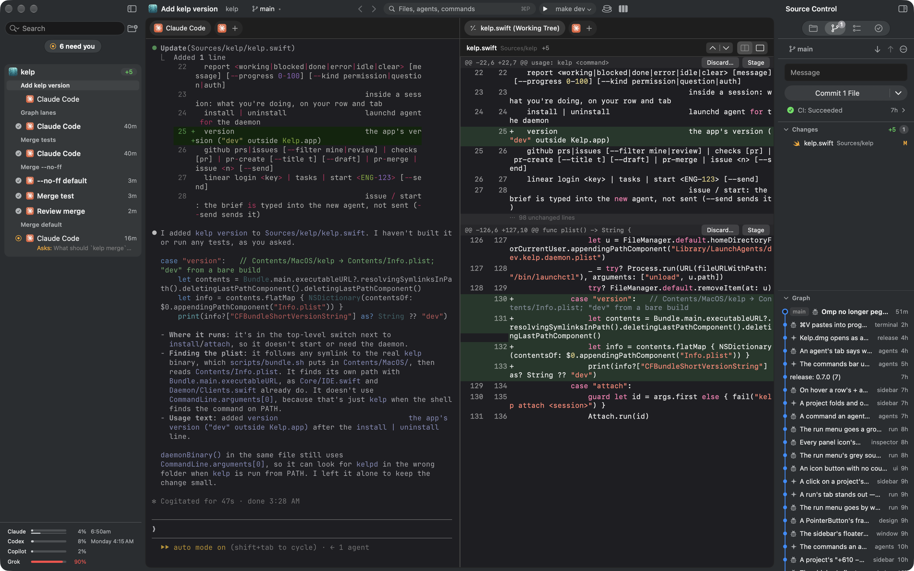
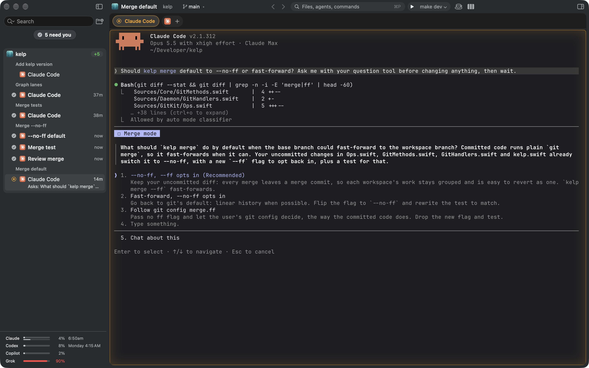

<div align="center">


# Kelp

**A native macOS IDE for coding agents.**<br/>
Between a classic editor like VS Code and an agent app like Claude Desktop: agents work side by side, and the code
they touch is one tab away to read, review and edit.

[](https://github.com/nikiomori/kelp/releases/latest)
[](https://github.com/nikiomori/kelp/actions/workflows/ci.yml)
[](LICENSE)
[](#install)

<p>
  <a href="#features"><b>Features</b></a> ·
  <a href="#install"><b>Install</b></a> ·
  <a href="#cli"><b>CLI</b></a> ·
  <a href="#extensions"><b>Extensions</b></a> ·
  <a href="docs/architecture.md"><b>Architecture</b></a>
</p>

<a href="https://github.com/nikiomori/kelp/releases/latest/download/Kelp.dmg">
  
</a>

<br/><br/>



<sub>*Three agents at work in one workspace, beside the file they're changing. The sidebar shows every workspace's agents.*</sub>

</div>

---

## Features

- **Code at hand.** Editor with language servers, file tree, diffs, browser; any tab in any split.
- **Agents first.** Claude Code, Codex, OpenCode, Gemini CLI and 17 more out of the box, or any CLI. Live status,
  review as a diff; agents keep working after you quit the app.
- **Git built in.** Source Control as in VS Code: stage or discard a hunk, commit, push, branch graph. Pull requests
  and CI from GitHub and GitLab; Linear and Jira issues.
- **Extensible.** Panels, commands and themes come from extensions; a JSON file is enough.
- **Native.** Swift + AppKit, terminal on libghostty. No Electron, no cloud, no telemetry.

<div align="center">



<sub>*An agent's change, its diff and Source Control side by side.*</sub>

<br/><br/>



<sub>*An agent asks before it changes anything. The sidebar counts who needs you; <kbd>⇧⌘U</kbd> goes to the next one.*</sub>

</div>

## Install

Requires macOS 14+. Download [`Kelp.dmg`](https://github.com/nikiomori/kelp/releases/latest/download/Kelp.dmg) and
drag Kelp to Applications; it updates itself (Kelp › Check for Updates…). Kelp's terminals have `kelp` on their PATH; for
other terminals: `ln -s /Applications/Kelp.app/Contents/MacOS/kelp /usr/local/bin/kelp`.

**Kelp Beta** is what's coming, ahead of a release: [`Kelp-Beta.dmg`](https://github.com/nikiomori/kelp/releases/download/beta/Kelp-Beta.dmg).
It installs beside Kelp as an app of its own (its settings, projects and agents in `~/.kelp-beta`) and updates itself
with each new beta. It can break; Kelp is unaffected. Channels, branches and releases: [docs/releasing.md](docs/releasing.md).

## Build and run

```sh
scripts/build-ghostty.sh         # once: libghostty into Vendor/ (downloads zig 0.16 into a cache)
swift build                      # everything
swift test                       # all tests
scripts/bundle.sh                # dist/Kelp.app + dist/Kelp.dmg (universal, release)
SIGN_ID="Developer ID Application: …" NOTARY_PROFILE=kelp scripts/bundle.sh   # signed + notarized
scripts/install.sh               # dist/Kelp.app over /Applications/Kelp.app, reopened; agents keep running (make release does both)
scripts/publish.sh               # GitHub release + update feed for that DMG (bump the version in Resources/Info.plist first)
scripts/bundle.sh beta           # Kelp Beta in dist/beta; scripts/publish-beta.sh publishes it (docs/releasing.md)
scripts/bundle.sh dev            # Kelp Dev: a debug build beside Kelp, with a copy of its projects (make dev)
```

For quick iteration: `swift build && .build/debug/KelpApp` (the app starts `kelpd` next to it if needed; a debug build
keeps its data in `~/.kelp-dev`, never Kelp's).

## CLI

Everything the window does, `kelp` does too, so agents can drive Kelp as well (`kelp help` lists it all).

```sh
kelp status
kelp session new --agent claude                                # in the workspace of the current folder
kelp session new --cmd "npm test" --split down --wait          # a tab beside yours; exits with the command's code
kelp open Sources/App.swift:42 --split right                   # a tab in the app
kelp worktree create feat/login | list | current | note "half done"
kelp terminal list | read <id> | send <id> "run the tests" | context <id>
kelp diff | commit "msg" | merge | push
kelp ext search | install <id>                                 # the extension library
kelp install                                                   # run the daemon as a LaunchAgent
```

Claude Code sessions get Kelp's skills for this (Settings › Agents): ask the agent for a panel, a setting or a theme.

## Per-repo config: `.kelp.yaml`

```yaml
setup: npm install              # runs in every new worktree
shared: node_modules            # symlinked from the main checkout instead of reinstalling
tabs: claude, shell             # sessions opened in each new worktree
run: npm run dev                # Run menu: run / test / lint / build (⌘R, ⌘U); script.<name> for any other
test: npm test
issueCommand: "Fix {title}: {body}"
recipe.commit: "Write a conventional commit for: {stagedPatch}"
```

Its commands run only after you trust the project in Kelp, and ask again when the file changes.
`.worktreeinclude` lists gitignored files (globs) copied into new worktrees, e.g. `.env*`.

## Extensions

An extension is a folder with an `extension.json` in `~/.kelp/extensions`: a panel that shows what a command prints,
commands, settings, themes, agents. Format: [docs/extensions.md](docs/extensions.md). Ready ones are in the
[library](https://github.com/nikiomori/kelp-extensions) (Settings › Extensions › Library, or `kelp ext search`).

## Architecture

See [docs/architecture.md](docs/architecture.md). License: MIT.
